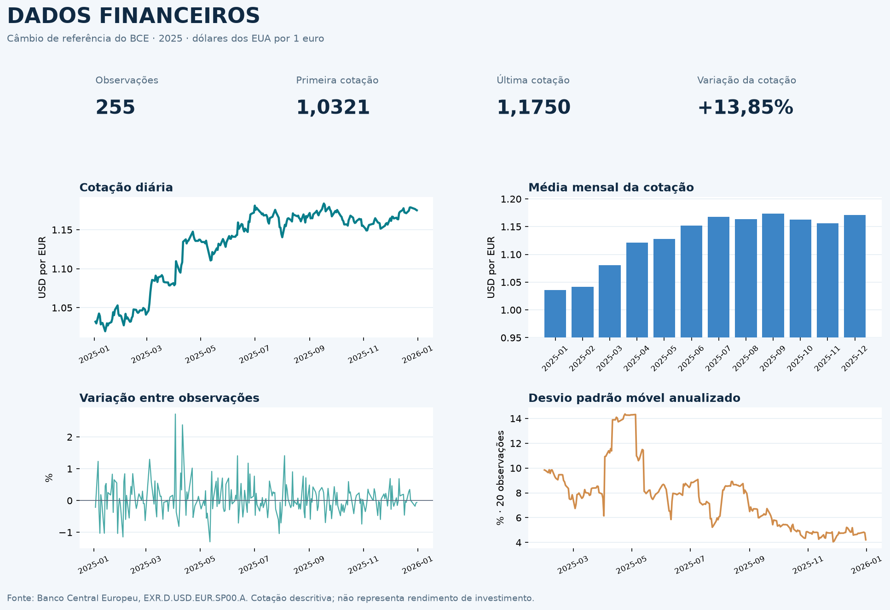

# Análise de dados financeiros: câmbio EUR/USD em 2025

Projeto de análise exploratória da **cotação de referência do Banco Central Europeu (BCE)**: dólares dos EUA por 1 euro, série `EXR.D.USD.EUR.SP00.A`. O período histórico de 2025 é fixo para que os resultados possam ser reproduzidos. O repositório inclui o CSV original, código de análise e dashboard.



## Perguntas respondidas

- Como a cotação mudou ao longo de 2025?
- Qual foi a média mensal e em que faixa a série oscilou?
- Quais variações diárias foram mais acentuadas?
- Como variou o desvio padrão móvel das mudanças da cotação?

## Como reproduzir

```bash
python -m venv .venv
# Ative o ambiente virtual de acordo com seu sistema
pip install -r requirements.txt
python analyze.py
```

Para atualizar o CSV com a mesma série e período, execute `python fetch_data.py` antes de `python analyze.py`. O script cria `report/processed_rates.csv`, `report/monthly_average.csv`, `report/metrics.json` e `report/dashboard.png`.

## Método e limites

- Verifica série, datas, duplicatas e cotações positivas; ordena as observações por data.
- Calcula variação percentual entre observações consecutivas. Fins de semana e feriados sem cotação não são preenchidos.
- A volatilidade mostrada é o desvio padrão móvel de 20 variações, multiplicado por `√252` apenas como convenção descritiva.
- O recuo da cotação mede a queda em relação ao maior valor observado até então; não é perda de uma carteira.
- Dados históricos não são previsão, recomendação de investimento nem resultado de operação. Não há dados de conta, robô ou estratégia de negociação neste repositório.

**Fonte:** [BCE — série EXR.D.USD.EUR.SP00.A](https://data.ecb.europa.eu/data/datasets/EXR/EXR.D.USD.EUR.SP00.A), acessada pela [API oficial](https://data.ecb.europa.eu/help/api/data-examples). Dados e atribuição: © European Central Bank. Consulte os [termos de uso do BCE](https://www.ecb.europa.eu/services/using-our-site/disclaimer/html/index.en.html).
